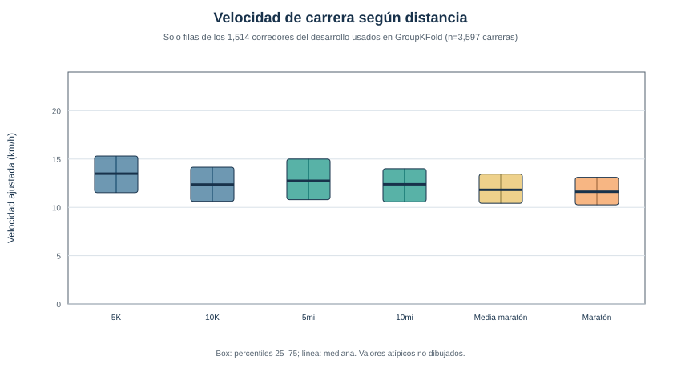
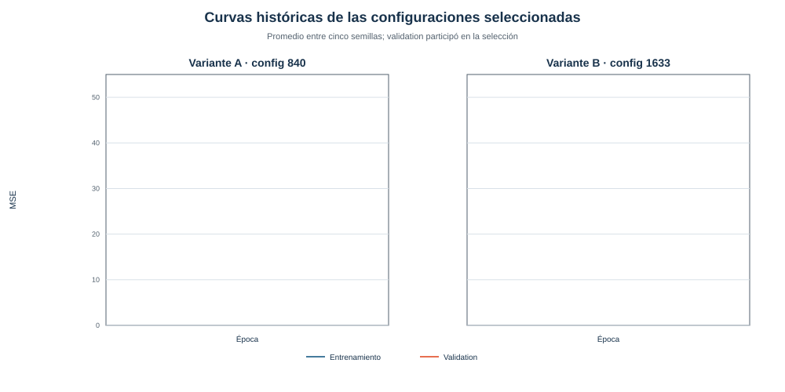
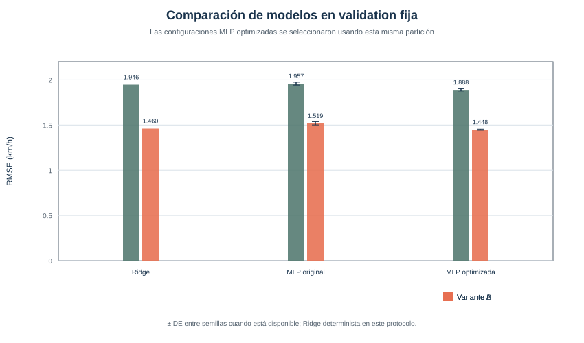
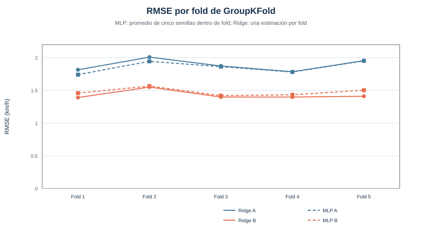

# Reporte final de investigación

## 1. Portada

**Título:** Aporte predictivo de las variables de entrenamiento en la estimación de velocidad de carrera de corredores recreativos

**Nombre:** [NOMBRE COMPLETO]  
**Matrícula:** [MATRÍCULA]  
**Materia:** TC3009C — Inteligencia Artificial Avanzada para la Ciencia de Datos  
**Profesor(a):** [NOMBRE DEL PROFESOR O PROFESORA]  
**Institución:** Tecnológico de Monterrey, Campus Monterrey  
**Fecha:** [DÍA, MES Y AÑO]

No se encontró una rúbrica del profesor en el repositorio; se utilizó una estructura académica estándar y se dejaron como campos editables los datos personales no disponibles.

## 2. Resumen

Este proyecto evalúa si las variables de entrenamiento aportan información predictiva adicional a un conjunto de características demográficas y de contexto de carrera para estimar la velocidad de corredores recreativos. Se empleó el dataset de Vickers y Vertosick (2016), transformado a formato largo, y se compararon dos bloques de predictores: A, con edad, BMI, sexo, distancia, calzado y antecedente de lesión; B, que agrega kilometraje típico y máximo, entrenamiento tipo sprint/intervalos, sesiones tempo y dos medidas de perfil de resistencia. Las particiones se agruparon por corredor y el escalado se ajustó exclusivamente con entrenamiento.

En la validación fija, el RMSE de Ridge disminuyó de 1.946 km/h en A a 1.460 km/h en B. Para MLP con configuración original y cinco semillas, el RMSE pasó de 1.957 ± 0.016 a 1.519 ± 0.018 km/h. Una búsqueda de hiperparámetros en validation alcanzó 1.888 ± 0.013 para A y 1.448 ± 0.006 para B. En la validación cruzada agrupada de cinco folds, los RMSE medios fueron 1.8874 ± 0.0937 (Ridge A), 1.4295 ± 0.0682 (Ridge B), 1.8563 ± 0.0948 (MLP A) y 1.4764 ± 0.0598 km/h (MLP B). Así, el bloque de entrenamiento se asoció con menor error en ambas familias; Ridge B obtuvo el menor RMSE promedio de CV y superó a MLP B en los cinco folds. La CV es una comparación condicionada a hiperparámetros elegidos previamente con validation, no una estimación completamente independiente del proceso de selección. Los análisis son predictivos y observacionales: no prueban causalidad ni que la no linealidad sea necesaria.

**Palabras clave:** regresión, MLP, Ridge, ablación grupal, validación cruzada agrupada, corredores recreativos.

## 3. Introducción

La predicción de tiempos de carrera con información accesible a los corredores es un problema aplicado de regresión. El desempeño depende de características de la persona, del entrenamiento y de la distancia; además, el dataset contiene varias carreras de una misma persona, de modo que las observaciones no son independientes entre sí.

Vickers y Vertosick (2016) estudiaron velocidad de carrera en una cohorte de corredores recreativos usando variables rutinarias como edad, sexo, BMI y hábitos de entrenamiento. Su artículo reporta asociaciones entre desempeño y kilometraje, intervalos y tempo, y examina cómo algunas asociaciones varían con la distancia. El presente proyecto retoma esos predictores en un problema de aprendizaje supervisado y compara Ridge, como referencia lineal regularizada, con una perceptrón multicapa (MLP).

La motivación inicial proponía que una MLP podría aprender interacciones no lineales entre demografía y entrenamiento. Esa posibilidad es una hipótesis de modelado, no una conclusión anticipada. El diseño compara primero bloques de predictores y después familias de modelos bajo protocolos documentados. La interpretación se limita a desempeño predictivo observado y no atribuye efectos causales al entrenamiento.

## 4. Planteamiento del problema

Cada corredor aporta resultados en más de una distancia. Si registros del mismo corredor aparecen tanto en entrenamiento como en evaluación, el modelo puede aprovechar información específica de esa persona y producir estimaciones demasiado optimistas para nuevos corredores. Por ello, la unidad de separación y validación debe ser el corredor (`id`), aunque la unidad de predicción sea una carrera.

El objetivo es predecir `velocity_kmh`, calculada como distancia en kilómetros dividida por `tiempo_ajustado_s` expresado en horas. Por tanto, es una velocidad basada en tiempo ajustado y no necesariamente la velocidad bruta observada. La distancia se conoce al plantear una predicción para una carrera concreta y se incluye en ambos modelos. `tiempo_ajustado_s` participa en la construcción de la respuesta, pero queda excluido como predictor. `dificultad` tampoco es predictor; su exclusión se mantiene aunque el tiempo ajustado forme parte de la respuesta. También se excluye la forma física reportada el día de la carrera.

La comparación central es una ablación por grupos: A representa el conjunto base y B agrega simultáneamente seis variables de entrenamiento. La unidad de comparación es el bloque completo; la diferencia entre A y B no cuantifica la contribución independiente de kilometraje, intervalos o tempo, ni el efecto causal de intervenir sobre entrenamiento.

## 5. Pregunta de investigación y objetivos

**Pregunta:** ¿Qué aporte predictivo conjunto ofrece el bloque de seis variables de entrenamiento, agregado simultáneamente a las variables demográficas y comunes de carrera, al predecir la velocidad con Ridge y MLP? La pregunta no estima aportes individuales ni efectos causales, y la comparación de modelos no presupone que las interacciones no lineales sean necesarias.

### Objetivo general

Cuantificar, mediante comparaciones predictivas A/B, el cambio de desempeño al agregar variables de entrenamiento a variables demográficas y comunes de carrera, y contrastar MLP con Ridge bajo los protocolos experimentales registrados.

### Objetivos específicos

1. Describir el dataset y verificar su transformación a una observación por carrera.
2. Establecer baselines exploratorios y un baseline de predicción por media.
3. Comparar Ridge y MLP entre A y B usando una partición fija por corredor.
4. Buscar configuraciones de MLP en validation y documentar las configuraciones elegidas.
5. Examinar la estabilidad comparativa de las configuraciones congeladas en cinco folds agrupados por corredor.
6. Interpretar resultados distinguiendo validación, CV y test, sin inferencias causales.

## 6. Marco teórico

### 6.1 Predicción de velocidad de carrera

La velocidad es una respuesta interpretable que integra distancia y tiempo. El artículo fuente estudió corredores recreativos mediante encuesta y analizó variables como edad, sexo, BMI, kilometraje, intervalos y tempo (Vickers & Vertosick, 2016). Su diseño y datos motivan los predictores de este proyecto; sus asociaciones publicadas no deben confundirse con resultados de este modelo ni trasladarse como efectos causales propios.

### 6.2 Regresión Ridge

Ridge minimiza una suma de errores cuadrados con una penalización L2 sobre los coeficientes. La penalización controla la magnitud de los coeficientes y es útil cuando los predictores están correlacionados (Hoerl & Kennard, 1970). En este proyecto sirve como referencia lineal: su buen desempeño indica que una función lineal regularizada puede capturar señal predictiva relevante, aunque no prueba que la relación real sea estrictamente lineal.

### 6.3 Perceptrón multicapa

Una MLP combina transformaciones afines con activaciones no lineales. Mediante retropropagación se ajustan sus parámetros a partir del gradiente de la pérdida (Rumelhart et al., 1986). Dropout apaga unidades durante entrenamiento como regularización estocástica (Srivastava et al., 2014); Adam adapta las tasas de actualización usando momentos del gradiente (Kingma & Ba, 2014). Estas propiedades permiten aproximar relaciones complejas, pero la capacidad expresiva no garantiza mejor desempeño con una muestra tabular finita.

### 6.4 Validación de observaciones agrupadas

Las carreras de un mismo corredor comparten características y pueden presentar dependencia. Una partición por filas permitiría que el modelo vea al mismo participante en entrenamiento y evaluación. La validación por grupos mantiene juntas las observaciones de cada persona; la literatura metodológica advierte que ignorar estructura jerárquica puede sesgar la estimación del error (Roberts et al., 2017). GroupKFold asigna cada grupo a un solo fold de evaluación.

### 6.5 Métricas

Se reportan RMSE, MAE y coeficiente de determinación R². RMSE es la raíz del error cuadrático medio y penaliza más los errores grandes; MAE es el error absoluto medio y mantiene la unidad de la respuesta; R² expresa desempeño relativo a la variación de la respuesta en el conjunto evaluado. RMSE y MAE se expresan en km/h. Las métricas resumen predicción, no importancia causal ni significancia inferencial por sí solas.

## 7. Descripción del dataset

El dataset proviene del material suplementario de Vickers y Vertosick (2016), estudio de una encuesta por Internet a corredores recreativos. El artículo reporta una cohorte final de 2,303 corredores y cuestionarios con dos o tres carreras recientes por participante. El archivo procesado incluido en este repositorio contiene 5,153 registros de carrera y 2,164 valores únicos de `id`. La documentación disponible no reconcilia la diferencia entre el tamaño de cohorte publicado y los IDs del Parquet; no se atribuye una causa sin evidencia.

El procesamiento convierte una tabla ancha a formato largo. Incluye seis distancias: 5K, 10K, 5 mi, 10 mi, media maratón y maratón. Para cada distancia se calcula `distancia_km` y se utiliza `tiempo_ajustado_s` para obtener `velocity_kmh`; por ello, el objetivo es velocidad basada en tiempo ajustado, no necesariamente velocidad bruta observada. El script `src/data_processing.py` descarta carreras sin tiempo ajustado válido o con tiempo no positivo; elimina distancia reportada y tiempo no ajustado, y conserva variables demográficas, entrenamiento, atributos de carrera y respuesta. `dificultad` no es predictor, aunque el tiempo ajustado se use para construir la respuesta.

### Variables del estudio

| Bloque | Variables | Uso |
|---|---|---|
| Demografía | `age`, `bmi`, `female` | Incluidas en A y B |
| Contexto pre-carrera/común | `distancia_km`, `footwear`, `injury` | Incluidas en A y B |
| Entrenamiento | `typical`, `max`, `sprint`, `tempo`, `endurancecat`, `endurancespeed` | Se agregan en B |
| Respuesta | `velocity_kmh` | Variable objetivo, km/h |
| Agrupación | `id` | Identificador de corredor; no es predictor |
| Excluidas de los predictores | `tiempo_ajustado_s`, `forma_fisica`, `dificultad`, `distancia` | `tiempo_ajustado_s` se usa solo para construir la respuesta; las demás no son predictores |

El artículo define kilometraje semanal típico y máximo, práctica habitual de intervalos y tempo, y atributos del corredor como la categoría/tipo de corredor y calzado. La transformación local renombra/codifica algunas variables; el repositorio no contiene un diccionario completo que permita reconstruir todas las etiquetas numéricas con certeza. No se asigna una interpretación más específica a `endurancecat` o `endurancespeed` que la respaldada por sus nombres y el cuestionario publicado.

## 8. Análisis exploratorio de datos

El notebook `01_eda_y_baselines.ipynb` documenta dimensiones, distribuciones, correlaciones, valores faltantes y riesgos de dependencia entre carreras. La tabla procesada contiene múltiples carreras por corredor (entre dos y tres en el EDA registrado). La velocidad basada en tiempo ajustado varía claramente por distancia, lo que justifica incluir `distancia_km` en A y B y separar por corredor en vez de por fila.

La Figura 1 muestra cuartiles de velocidad para las filas de los 1,514 corredores que conforman el conjunto de entrenamiento usado posteriormente en GroupKFold (3,597 carreras). Se generó a partir de esos IDs de entrenamiento, no del conjunto test. Las medianas en este subconjunto van de 11.607 km/h para maratón a 13.479 km/h para 5K; las distribuciones se superponen y presentan dispersión dentro de cada distancia.

| Distancia | Carreras en desarrollo-train | Mediana (km/h) | Q1–Q3 (km/h) |
|---|---:|---:|---:|
| 5K | 905 | 13.479 | 11.518–15.312 |
| 10K | 615 | 12.354 | 10.623–14.154 |
| 5 mi | 202 | 12.748 | 10.795–14.996 |
| 10 mi | 212 | 12.383 | 10.568–13.996 |
| Media maratón | 1,010 | 11.811 | 10.412–13.439 |
| Maratón | 653 | 11.607 | 10.250–13.105 |

El EDA histórico identificó correlación alta entre `typical` y `max` (aproximadamente 0.91, según el notebook de optimización). Se conservaron ambas durante la búsqueda y se hizo un análisis de sensibilidad. Esta correlación implica información redundante potencial y afecta la interpretación de coeficientes, pero no justifica por sí sola borrar una característica. El análisis por filas tampoco sustituye una inferencia que trate explícitamente la dependencia intracorredor.

### Baselines exploratorios y su alcance

El notebook EDA inicial reporta en validation un baseline de media por sexo (RMSE 2.441 km/h; MAE 1.988 km/h), Ridge (1.454; 1.140) y MLP (1.503; 1.166). No reporta R² en esa tabla. El baseline Ridge/MLP de ese notebook utiliza un bloque amplio de 14 predictores que incluye `forma_fisica` y `dificultad`, excluidas después de la especificación pre-carrera. Por ello, sus valores se preservan como evidencia de viabilidad del pipeline, pero no se comparan directamente con los modelos A/B ni se interpretan como una estimación válida del predictor final. La media por sexo no utiliza esas variables y constituye solo un baseline descriptivo.

En la ablación principal se usa además una predicción constante con la media de velocidad del train: RMSE 2.746 km/h, MAE 2.235 km/h y R² = -0.001. Esta referencia utiliza la misma partición fija y es el baseline adecuado para la tabla de ablación.

## 9. Preprocesamiento y selección de variables

### Construcción de la respuesta

Para cada carrera se calcula:

\[
\text{velocity\_kmh}=\frac{\text{distancia\_km}}{\text{tiempo\_ajustado\_s}/3600}.
\]

El tiempo ajustado interviene en la definición del objetivo —por lo que la respuesta es velocidad basada en tiempo ajustado, no necesariamente velocidad bruta observada—, pero no aparece en la matriz de predictores. `dificultad` tampoco es predictor. La distancia se mantiene porque se conoce al solicitar la predicción de una carrera a distancia definida. Su relación algebraica con la respuesta se reconoce como parte de la tarea condicionada a distancia, no se oculta.

### Variantes A y B

**A — base demográfica y variables comunes:** `age`, `bmi`, `female`, `distancia_km`, `footwear`, `injury`.

**B — base más entrenamiento:** todas las variables de A y `typical`, `max`, `sprint`, `tempo`, `endurancecat`, `endurancespeed`.

La unidad de comparación de la ablación es el bloque completo de seis predictores, agregado simultáneamente entre A y B. Los resultados no cuantifican contribuciones independientes de kilometraje, sprint/intervalos, tempo o perfiles de resistencia.

### Particiones y escalado

La partición fija aplica GroupShuffleSplit en dos etapas, semilla 42: 15% de corredores para test reservado, luego una fracción que representa 15% del total para validation, y el resto para train. El registro de ejecución informa 1,839 corredores en desarrollo (train más validation) y 325 en test; el notebook de CV toma los 1,514 corredores del train original y deja fuera validation/test para los folds. No se mezclan carreras de un corredor entre conjuntos.

Para cada variante, StandardScaler se ajusta con train y se aplica a validation/evaluación con los parámetros aprendidos en train. En CV el escalador se vuelve a ajustar dentro de cada fold usando solo el entrenamiento del fold. No se reporta estandarización de la respuesta. `id` se conserva solo para crear grupos.

## 10. Metodología experimental

La secuencia documentada es:

1. **EDA y baseline:** inspección de datos, riesgos y comparación inicial Ridge/MLP; se interpreta con cautela por su conjunto amplio de características.
2. **Ablación:** Ridge y MLP se comparan en A y B sobre la partición fija, con el test reservado. La MLP original usa cinco inicializaciones (semillas 0–4) y 80 épocas, sin selección por validation en este experimento.
3. **Optimización:** una búsqueda aleatoria selecciona 150 de 2,016 configuraciones con una inicialización de búsqueda y early stopping. Las diez mejores por variante se evalúan con cinco nuevas semillas (100–104). La selección de configuraciones depende de RMSE en validation.
4. **CV agrupada:** GroupKFold de cinco folds sobre el train original (1,514 corredores, 3,597 carreras), sin incorporar el validation fijo ni el test. Los MLP usan cinco semillas (300–304) por fold. En cada fold, early stopping se realiza en una partición interna agrupada; después la MLP se inicializa desde cero y se entrena con todo el entrenamiento del fold durante el número de épocas escogido. Ridge se entrena una vez por fold y variante.
5. **Ejecución sobre test no autorizada:** una herramienta de IA inició una ejecución sobre el conjunto test sin que hubiera solicitud ni autorización explícita; no fue una decisión deliberada del diseño experimental. Sus resultados no se utilizaron para seleccionar modelos, ajustar hiperparámetros ni elaborar conclusiones, por lo que no se presentan métricas de test como resultados confirmatorios. Por separado, `resultados/ejecucion.json` registra parámetros que no coinciden con los del protocolo v2 descrito (MLP 840/1633, Ridge alpha=1e-6/100 para CV y semillas 500–504 para la evaluación final); al no encontrarse manifiesto, driver ni documento v2, su relación con ese protocolo no está corroborada.

La CV no es nested CV: los hiperparámetros de MLP y los alphas de Ridge ya se habían seleccionado usando validation antes de fijar la comparación de CV. La separación del test y la CV por corredor evita determinadas fugas de identidad, pero no elimina el sesgo inducido por la selección previa de hiperparámetros. Por eso se describe como análisis de estabilidad comparativa en folds, no como estimación independiente completa del procedimiento de selección.

## 11. Modelos y arquitecturas

### Ridge

Ridge con entradas estandarizadas es el comparador lineal. En la ablación fija se usa alpha=1. En la CV histórica se usan alpha=1e-6 para A y alpha=100 para B; esos valores se seleccionaron previamente con validation. El alpha de A está en el límite inferior de la malla de búsqueda documentada, por lo que no debe interpretarse como un óptimo interior bien determinado. No se deben intercambiar las cifras de ambos protocolos como si provinieran del mismo ajuste.

### MLP original

La arquitectura original tiene dos capas ocultas con 64 y 32 unidades, ReLU y dropout 0.2, seguidas por una salida escalar para regresión. Se entrena con pérdida MSE, Adam, tasa de aprendizaje 0.001, weight decay 0.0001 y lotes de 64 durante 80 épocas en el experimento de ablación. La inicialización varía entre semillas.

### MLP optimizada

Las configuraciones seleccionadas en la búsqueda son:

| Variante | ID de configuración | Capas ocultas | Optimizador | lr | Dropout | Weight decay | Batch |
|---|---:|---|---|---:|---:|---:|---:|
| A | 840 | (128,) | Adam | 0.003 | 0.2 | 0.001 | 32 |
| B | 1633 | (128, 64, 32) | AdamW | 0.001 | 0.2 | 0.001 | 32 |

Ambas usan ReLU y early stopping con paciencia 15 y máximo 200 épocas durante búsqueda. En CV se conserva la configuración seleccionada y se elige número de épocas en una validación interna del fold; la valoración de estas elecciones permanece condicionada por la búsqueda previa en validation.

## 12. Optimización de hiperparámetros

El espacio histórico comprendió siete arquitecturas, cuatro tasas de aprendizaje, cuatro niveles de dropout, tres niveles de weight decay, tres tamaños de lote y dos optimizadores, para 2,016 combinaciones. Se muestrearon 150 configuraciones sin reemplazo con semilla 42. La primera etapa evaluó cada configuración en A y B con semilla de inicialización 0; para la segunda etapa se tomaron las diez mejores configuraciones de cada variante y se evaluaron con cinco semillas (100–104). La selección se hizo con validation, no con test.

La Figura 2 muestra las curvas guardadas para las configuraciones elegidas. Las bandas representan desviación estándar entre las cinco semillas. Se usan como diagnóstico del proceso de ajuste, no como prueba independiente: la validación fue usada para ordenar y seleccionar configuraciones.

## 13. Resultados

Todas las cifras de esta sección provienen de CSV históricos de validation o CV. No se incorporan métricas del test.

### 13.1 Baselines

| Protocolo y modelo | Predictores | RMSE (km/h) | MAE (km/h) | R² |
|---|---|---:|---:|---:|
| EDA: media por sexo | sexo | 2.441 | 1.988 | No reportado |
| EDA: Ridge | bloque EDA amplio, incluye forma física y dificultad | 1.454 | 1.140 | No reportado |
| EDA: MLP | bloque EDA amplio, incluye forma física y dificultad | 1.503 | 1.166 | No reportado |
| Ablación: media constante de train | constante, misma partición fija | 2.746 | 2.235 | -0.001 |

Los modelos EDA usan un conjunto de características diferente al de A/B; sus métricas se incluyen para reconstruir la secuencia del proyecto, no para ordenar directamente el rendimiento de los modelos finales.

### 13.2 Ablación A frente a B en validation fija

| Modelo | Variante | RMSE (km/h) | MAE (km/h) | R² |
|---|---|---:|---:|---:|
| Ridge, alpha=1 | A | 1.946 | 1.573 | 0.497 |
| Ridge, alpha=1 | B | 1.460 | 1.145 | 0.717 |
| MLP original, 80 épocas, 5 semillas | A | 1.957 ± 0.016 | 1.554 ± 0.010 | 0.492 ± 0.008 |
| MLP original, 80 épocas, 5 semillas | B | 1.519 ± 0.018 | 1.182 ± 0.021 | 0.693 ± 0.007 |

Para las dos familias, la variante B redujo el error frente a A. Este contraste estima el cambio asociado a agregar el bloque como conjunto, bajo la validación fija; no descompone la reducción entre sus variables.

### 13.3 Sensibilidad de variables correlacionadas

En el notebook de optimización, Ridge B obtuvo RMSE 1.460 y al quitar `typical` subió a 1.484; al quitar `max` obtuvo 1.471. En MLP, B completo tuvo RMSE medio 1.519 ± 0.018; sin `typical`, 1.543 ± 0.012; sin `max`, 1.524 ± 0.015. Este análisis de sensibilidad informa redundancia predictiva potencial; no estima una importancia individual libre de dependencia y no se usó para eliminar variables.

El diagnóstico de una interacción lineal adicional reporta Ridge B RMSE 1.460 frente a 1.459 al añadir `tempo × distancia`, con MAE y R² redondeados iguales (1.145 y 0.717). La diferencia observada de RMSE es muy pequeña y no demuestra que una interacción concreta explique la mejora del bloque.

### 13.4 Resultados de optimización en validation

| MLP | Protocolo | RMSE (km/h) | MAE (km/h) | R² |
|---|---|---:|---:|---:|
| A original | Early stopping, semillas 100–104 | 1.919 ± 0.007 | 1.535 ± 0.006 | 0.511 ± 0.004 |
| A optimizada, config 840 | Early stopping, semillas 100–104 | 1.888 ± 0.013 | 1.511 ± 0.013 | 0.527 ± 0.007 |
| B original | Early stopping, semillas 100–104 | 1.492 ± 0.019 | 1.161 ± 0.017 | 0.705 ± 0.008 |
| B optimizada, config 1633 | Early stopping, semillas 100–104 | 1.448 ± 0.006 | 1.131 ± 0.007 | 0.722 ± 0.002 |

La tabla compara MLP bajo un protocolo de early stopping común, en cinco semillas. El notebook reporta que la configuración seleccionada para B alcanza RMSE medio inferior al Ridge B de alpha=1 en esta validation (1.448 frente a 1.460 km/h); al haberse seleccionado las configuraciones con la misma validation, esta diferencia no constituye una comparación confirmatoria.

### 13.5 Validación cruzada agrupada

La Tabla siguiente resume media y desviación estándar entre los cinco folds. Para MLP, primero se promediaron las cinco semillas de cada fold y la desviación de la tabla describe variación entre folds. Para Ridge hay un resultado por fold.

| Modelo | RMSE (km/h), media ± DE | MAE (km/h), media ± DE | R², media ± DE |
|---|---:|---:|---:|
| Ridge A, alpha=1e-6 | 1.8874 ± 0.0937 | 1.4774 ± 0.0757 | 0.4462 ± 0.0599 |
| MLP A, config 840 | 1.8563 ± 0.0948 | 1.4511 ± 0.0754 | 0.4632 ± 0.0674 |
| Ridge B, alpha=100 | **1.4295 ± 0.0682** | **1.0976 ± 0.0434** | **0.6824 ± 0.0339** |
| MLP B, config 1633 | 1.4764 ± 0.0598 | 1.1310 ± 0.0401 | 0.6616 ± 0.0247 |

En la comparación pareada por fold de `MLP B − Ridge B`, la diferencia media de RMSE fue +0.0469 km/h, de MAE +0.0334 km/h y de R² -0.0208; Ridge B tuvo menor RMSE en los cinco folds. Para B frente a A, la diferencia media de RMSE fue -0.3800 km/h y B tuvo menor RMSE en los cinco folds. El número de folds es pequeño y las configuraciones se eligieron con validation; estos resultados se interpretan como estabilidad comparativa del protocolo, no como prueba universal de superioridad ni una prueba inferencial independiente.

### 13.6 Validation y CV: protocolos distintos

| Variante/modelo | Validation fija | CV agrupada, media ± DE de folds | Observación de protocolo |
|---|---:|---:|---|
| Ridge A | 1.946 (alpha=1) | 1.8874 ± 0.0937 (alpha=1e-6) | Cambia alpha; selección CV previa en validation |
| MLP A optimizada | 1.888 ± 0.013 | 1.8563 ± 0.0948 | Configuración seleccionada con validation; CV en train original |
| Ridge B | 1.460 (alpha=1) | 1.4295 ± 0.0682 (alpha=100) | Cambia alpha; selección CV previa en validation |
| MLP B optimizada | 1.448 ± 0.006 | 1.4764 ± 0.0598 | Configuración seleccionada con validation; CV en train original |

Esta tabla facilita la lectura entre fases, pero los valores no forman pares evaluados sobre las mismas observaciones. Validation usa la partición fija que seleccionó hiperparámetros; CV usa cinco particiones distintas de los corredores de train y configuraciones congeladas. Las diferencias entre columnas no se interpretan como cambio temporal de capacidad ni como una estimación de optimismo independiente.

## 14. Discusión

### Aporte del bloque de entrenamiento

La evidencia más consistente es la reducción de error al pasar de A a B. En validation fija, RMSE disminuyó 0.486 km/h para Ridge y 0.438 km/h para la MLP original; el MLP optimizado B también obtuvo menor RMSE que A. En CV, B tuvo menor RMSE que A para ambas familias en cada fold. Esto respalda que el conjunto de variables de entrenamiento contiene señal predictiva incremental bajo estas particiones y especificaciones.

El resultado no permite atribuir la ganancia a `typical`, `max`, intervalos o tempo de manera independiente. Las seis variables se agregaron y evaluaron simultáneamente como un bloque; además, `typical` y `max` están fuertemente correlacionadas. La sensibilidad de retirar una variable cada vez ofrece evidencia descriptiva de robustez/redundancia, no un análisis causal ni una estimación de importancia individual definitiva.

### ¿Es necesaria la no linealidad?

No. Aunque la mejor MLP B tuvo un RMSE 0.012 km/h menor que Ridge B en la validation fija, el resultado está condicionado a la búsqueda sobre esa validation. En CV, Ridge B obtuvo RMSE promedio 1.4295 km/h frente a 1.4764 km/h para MLP B, así como menor MAE y mayor R²; la dirección favoreció Ridge en los cinco folds. Esta evidencia no respalda afirmar que la MLP sea superior para B ni que las interacciones no lineales sean necesarias. Tampoco prueba que todas las relaciones sean lineales: solo compara estas implementaciones, entradas y ajustes.

Para A, MLP tuvo una ventaja descriptiva pequeña frente a Ridge en CV (diferencia RMSE media MLP−Ridge de -0.0311 km/h), pero la variación entre folds fue comparable y el contraste no establece superioridad general. La elección del modelo debe considerar desempeño, estabilidad, complejidad y el objetivo de uso, no solo la capacidad teórica de la arquitectura.

### Papel de la validación cruzada

La agrupación por corredor es una decisión adecuada porque evita compartir participantes entre folds y representa mejor la predicción para corredores no observados que una división aleatoria por carrera. Sin embargo, la CV posterior no fue nested: alphas de Ridge y configuraciones MLP se habían seleccionado mediante validation. Por tanto, no evalúa un proceso completamente independiente de selección. Su utilidad principal aquí es observar cómo cambia la comparación entre subconjuntos de corredores, dejando explícita la dependencia del protocolo previo.

## 15. Limitaciones

1. **Selección de hiperparámetros y CV:** la CV no envuelve todo el proceso de selección; la configuración elegida en validation puede conservar sesgo de selección. Además, alpha de Ridge A quedó en el límite inferior de la malla examinada.
2. **Ejecución no autorizada y alcance de test:** una herramienta de IA inició la ejecución sin solicitud ni autorización explícita; no fue una decisión deliberada del diseño experimental. Sus resultados no se usaron para selección, ajuste ni conclusiones y no se presentan como confirmatorios. La relación de `ejecucion.json` con el protocolo v2 no está corroborada. El objetivo es velocidad basada en `tiempo_ajustado_s`, no necesariamente velocidad bruta observada; `dificultad` no es predictor.
3. **Ablación grupal:** A/B mide el aporte predictivo conjunto de seis variables agregadas simultáneamente, no sus contribuciones independientes ni efectos causales.
4. **Muestra y medición:** los predictores y tiempos proceden de encuesta/autorreporte; puede haber error de recuerdo y sesgo de selección. La muestra de corredores recreativos no representa necesariamente otros grupos.
5. **Dependencia y heterogeneidad:** cada corredor tiene varias distancias; agrupación mitiga fuga de identidad, pero distancias, condiciones de carrera y mediciones repetidas siguen generando heterogeneidad.
6. **Diferencia de conteos:** el artículo informa 2,303 corredores, mientras el Parquet local contiene 2,164 IDs; la documentación disponible no reconcilia estos conteos.
7. **Variables codificadas:** el repositorio no contiene un diccionario completo de categorías para todas las variables de entrenamiento/calzado.
8. **Comparabilidad entre fases:** Ridge cambia de alpha entre la comparación fija y CV; MLP cambia de configuración y protocolo de entrenamiento. Los resultados se presentan separados y no como si fueran idénticas condiciones.
9. **Reproducibilidad computacional:** no existe lockfile y el rendimiento puede variar entre versiones y dispositivos. Este reporte no vuelve a ejecutar entrenamiento ni búsqueda.

## 16. Conclusiones

En las comparaciones realizadas, agregar simultáneamente el bloque de seis variables de entrenamiento a las variables demográficas y comunes de carrera se asoció con menor error de predicción. El patrón apareció para Ridge y MLP en la validación fija y fue consistente por fold en la CV agrupada. Es evidencia de valor predictivo adicional del bloque para esta muestra y protocolo; no permite cuantificar aportes independientes ni afirmar que modificar el entrenamiento cause una mejora.

Ridge B obtuvo el mejor promedio de CV entre los modelos comparados: RMSE 1.4295 ± 0.0682 km/h, frente a 1.4764 ± 0.0598 para MLP B. Por tanto, la evidencia no establece que una MLP ni la no linealidad sean necesarias. La MLP optimizada B sí tuvo un resultado ligeramente menor que Ridge B en la validation fija, pero esa validación también guio la selección de hiperparámetros.

La validación agrupada por corredor refuerza una comparación más realista que separar carreras al azar, pero no equivale a una validación anidada e independiente. Con un protocolo nested de selección dentro de cada fold y una evaluación externa formalmente autorizada podría estimarse con mayor independencia el desempeño del proceso completo. Esa recomendación corresponde a trabajo futuro; no se ejecutó para este reporte.

## 17. Referencias bibliográficas

Hoerl, A. E., & Kennard, R. W. (1970). Ridge regression: Biased estimation for nonorthogonal problems. *Technometrics, 12*(1), 55–67. https://doi.org/10.1080/00401706.1970.10488634

Kingma, D. P., & Ba, J. (2014). *Adam: A method for stochastic optimization*. arXiv. https://doi.org/10.48550/arXiv.1412.6980

Roberts, D. R., Bahn, V., Ciuti, S., Boyce, M. S., Elith, J., Guillera-Arroita, G., Hauenstein, S., Lahoz-Monfort, J. J., Schröder, B., Thuiller, W., Warton, D. I., Wintle, B. A., Hartig, F., & Dormann, C. F. (2017). Cross-validation strategies for data with temporal, spatial, hierarchical, or phylogenetic structure. *Ecography, 40*(8), 913–929. https://doi.org/10.1111/ecog.02881

Rumelhart, D. E., Hinton, G. E., & Williams, R. J. (1986). Learning representations by back-propagating errors. *Nature, 323*(6088), 533–536. https://doi.org/10.1038/323533a0

Srivastava, N., Hinton, G., Krizhevsky, A., Sutskever, I., & Salakhutdinov, R. (2014). Dropout: A simple way to prevent neural networks from overfitting. *Journal of Machine Learning Research, 15*(56), 1929–1958. https://jmlr.org/papers/v15/srivastava14a.html

Vickers, A. J., & Vertosick, E. A. (2016). An empirical study of race times in recreational endurance runners. *BMC Sports Science, Medicine and Rehabilitation, 8*, Article 26. https://doi.org/10.1186/s13102-016-0052-y

## 18. Apéndices técnicos

### A. Registro de ejecución y protocolo v2: identidad no corroborada

`resultados/ejecucion.json` conserva metadatos de una ejecución con partición agrupada, MLP `(64, 32)`, Ridge alpha=1 y semillas `[0, 1, 2]`. No se pudo corroborar si corresponde a la ejecución sobre test iniciada por una herramienta de IA ni al protocolo v2. Sus parámetros difieren del protocolo v2 descrito y el JSON no se presenta como evidencia de ese protocolo. La ejecución sobre test fue iniciada por una herramienta de IA sin que hubiera solicitud ni autorización explícita; no fue una decisión del diseño experimental. Sus resultados no se utilizaron para seleccionar modelos, ajustar hiperparámetros ni elaborar conclusiones. Por esa razón, este reporte no presenta métricas de test como resultados confirmatorios.

### B. Correspondencia de resultados

| Evidencia | Fuente primaria del repositorio |
|---|---|
| Baseline EDA y métricas iniciales | `analisis_exploratorio/01_eda_y_baselines.ipynb` |
| Ablación Ridge/MLP, cinco semillas, sensibilidad a interacción | `resultados/02_ablacion_lineal.csv`, `resultados/02_ablacion_mlp_resumen.csv`, `resultados/02_ridge_interaccion.csv` |
| Búsqueda y configuraciones elegidas | `resultados/03_busqueda_etapa1.csv`, `resultados/03_busqueda_etapa2_resumen.csv`, `resultados/03_comparacion_final_validacion.csv` |
| Curvas de entrenamiento/validation | `resultados/03_curvas_mejores.csv` |
| Métricas y diferencias GroupKFold | `resultados/04_cv_resumen.csv`, `resultados/04_cv_metricas_por_fold.csv`, `resultados/04_cv_diferencias.csv` |
| Folds de desarrollo y metadatos de ejecución registrados | `resultados/04_cv_folds_train.csv`, `resultados/04_ridge_alpha_mejor.csv`, `resultados/ejecucion.json` |
